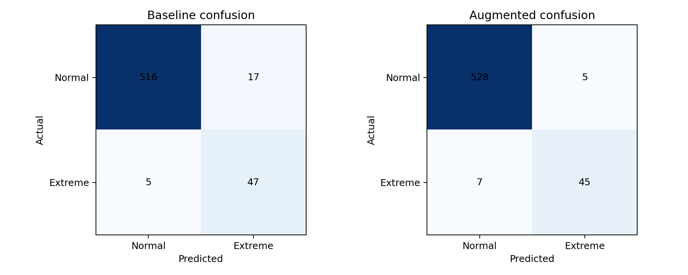
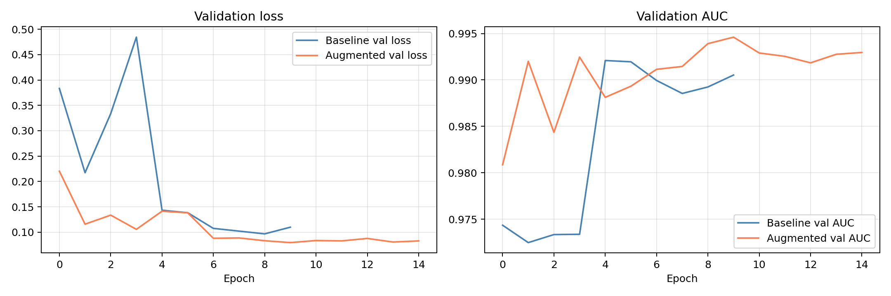

# Extreme Weather Detection from ERA5 Reanalysis Data (CNN + GAN Augmentation)

A convolutional neural network (CNN) that classifies ERA5 reanalysis weather grids as **extreme** or **normal**, and a controlled experiment testing whether adding **GAN-generated synthetic extreme events** improves detection on a heavily imbalanced dataset (about 9% extreme).

> **Group project** (MSc Data Analytics, National College of Ireland, Deep Learning & Generative AI).
> **My contribution:** the CNN classifier, the training and evaluation pipeline, and the baseline vs GAN-augmented comparison in this repository.
> The GAN used to generate the synthetic images and the other models in the team's wider multimodal fusion system were built by my teammates and are not part of this repository.

## Problem

Extreme weather events are rare, so a classifier trained on raw data sees very few positive examples. This project asks: **does augmenting the training set with GAN-generated extreme-event samples improve detection, and at what cost?**

## Data

| File | Shape | Description |
|---|---|---|
| `data/era5_images.npy` | 2,922 x 17 x 21 x 5 | ERA5 spatial grids (17 x 21 grid points, 5 meteorological channels) |
| `data/era5_labels.npy` | 2,922 | 1 = extreme event, 0 = normal (about 8.9% positive) |
| `data/gan_synthetic_images.npy` | 260 x 17 x 21 x 5 | GAN-generated synthetic extreme-event grids (added to the training set only) |

Source: ERA5 reanalysis, Copernicus Climate Change Service / ECMWF (contains modified Copernicus data).

## Method

1. **Split:** stratified 64 / 16 / 20 train / validation / test split (seed 42).
2. **Standardise** using the training set's mean and standard deviation only (no leakage into validation or test).
3. **CNN:** three Conv-BatchNorm-ReLU blocks (32, 64, 128 filters), global average pooling, a dense layer with dropout, and L2 regularisation; sigmoid output; Adam optimiser.
4. **Class imbalance:** balanced class weights.
5. **Training:** early stopping on validation AUC and learning-rate reduction on plateau.
6. **Two runs on the same test set:** (a) baseline, original training data; (b) augmented, original training data plus the 260 GAN images labelled as extreme. GAN images are never used for validation or testing.

## Results (held-out test set, 585 samples, 52 extreme)

| Metric | Baseline CNN | CNN + GAN augmentation |
|---|---|---|
| Accuracy | 0.962 | **0.979** |
| Precision | 0.734 | **0.900** |
| Recall | **0.904** | 0.865 |
| F1 | 0.810 | **0.882** |
| ROC-AUC | 0.989 | **0.991** |
| CSI (critical success index) | 0.681 | **0.789** |
| False alarm ratio | 0.266 | **0.100** |
| False alarms (false positives) | 17 | **5** |
| Missed events (false negatives) | **5** | 7 |




**Takeaway:** GAN augmentation sharply reduced false alarms (17 to 5) and raised F1 and CSI, at the cost of two additional missed events. Whether that trade-off is worth it depends on the application: early-warning systems may prefer higher recall.

## Run it

```bash
git clone https://github.com/Mithillessh/era5-extreme-weather-cnn.git
cd era5-extreme-weather-cnn
pip install -r requirements.txt
python cnn_era5_classifier.py
```

Outputs (metrics, predictions, training histories, plots and the trained model) are written to `results/`. Results shown here come from a single run with seed 42; exact numbers can vary slightly across machines and TensorFlow versions.

## Limitations

- Single train / validation / test split and single seed; no confidence intervals, so differences between the two models should be read as indicative.
- Only 52 extreme events in the test set, so each missed or false-alarm case moves the metrics noticeably.
- A fixed 0.5 decision threshold was used; tuning it would change the precision / recall balance.

## Tech stack

Python, TensorFlow / Keras, scikit-learn, NumPy, Pandas, Matplotlib.

## Author

Mithillessh Vennila Sigamani: MSc Data Analytics, National College of Ireland.
